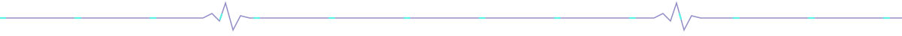

<picture>
  <source media="(prefers-color-scheme: dark)" srcset="./assets/hero-dark.svg">
  <source media="(prefers-color-scheme: light)" srcset="./assets/hero-light.svg">
  
</picture>

  
  
  
  

I keep production systems running by day and build tools that make learning and work less tedious by night. Python is home. React is where my visualizers live. Somewhere in between, I write poems.

<picture>
  <source media="(prefers-color-scheme: dark)" srcset="./assets/divider-dark.svg">
  <source media="(prefers-color-scheme: light)" srcset="./assets/divider-light.svg">
  
</picture>

### Building now

  <a href="https://github.com/Tanishk901/invert">
    <picture>
      <source media="(prefers-color-scheme: dark)" srcset="./assets/invert-dark.svg">
      <source media="(prefers-color-scheme: light)" srcset="./assets/invert-light.svg">
      
    </picture>
  </a>
  <a href="https://github.com/Tanishk901/inbox-triage">
    <picture>
      <source media="(prefers-color-scheme: dark)" srcset="./assets/triage-dark.svg">
      <source media="(prefers-color-scheme: light)" srcset="./assets/triage-light.svg">
      
    </picture>
  </a>

**INVERT** teaches data structures and algorithms by letting you step through them: Two Sum, Binary Search, Valid Parentheses, Reverse Linked List, Sliding Window and Two Pointers, each one algorithmically correct, not a fake progress bar.

**inbox-triage** reads a support inbox, asks an LLM whether each email is a service request or an incident, and logs the call to Excel. No ticketing-system API keys needed.

<picture>
  <source media="(prefers-color-scheme: dark)" srcset="./assets/divider-dark.svg">
  <source media="(prefers-color-scheme: light)" srcset="./assets/divider-light.svg">
  
</picture>

### Tools I reach for

<picture>
  <source media="(prefers-color-scheme: dark)" srcset="https://skillicons.dev/icons?i=python,cpp,react,js,flutter,blender,unity,git&theme=dark&perline=8">
  <source media="(prefers-color-scheme: light)" srcset="https://skillicons.dev/icons?i=python,cpp,react,js,flutter,blender,unity,git&theme=light&perline=8">
  
</picture>

### A year of commits, eaten daily

<picture>
  <source media="(prefers-color-scheme: dark)" srcset="https://raw.githubusercontent.com/Tanishk901/Tanishk901/output/snake-dark.svg">
  <source media="(prefers-color-scheme: light)" srcset="https://raw.githubusercontent.com/Tanishk901/Tanishk901/output/snake-light.svg">
  
</picture>

### Latest writing

<!-- BLOG-POST-LIST:START -->
<!-- BLOG-POST-LIST:END -->

<picture>
  <source media="(prefers-color-scheme: dark)" srcset="./assets/divider-dark.svg">
  <source media="(prefers-color-scheme: light)" srcset="./assets/divider-light.svg">
  
</picture>

Open to collaborating on AI tools, learning apps and anything that moves on screen.

